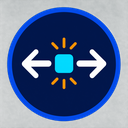
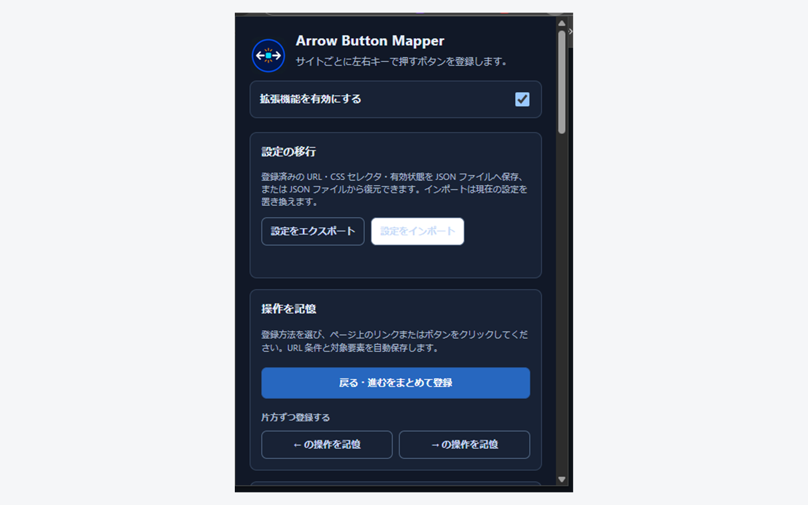

<div align="center">



# Arrow Button Mapper

**Web ページの「前へ」「次へ」を、`←` / `→` キーで。**

サイトごとにリンクやボタンを矢印キーへ割り当てる Chrome 拡張機能。CSS セレクタを書かずに、
ページ上の要素をクリックするだけで登録できます。

[](LICENSE)
[](manifest.json)

[プライバシーポリシー](docs/chrome-web-store/privacy-policy.md) ·
[ストア掲載情報](docs/chrome-web-store/listing.md) ·
[Issues](https://github.com/tonbiattack/arrow-button-mapper/issues)

</div>



## 特徴

- **クリックだけで登録** — `←` か `→` を選び、ページ上の対象を 1 回クリックするだけ。CSS セレクタの知識は不要
- **ページ番号が変わっても動く** — URL の固定部分とページネーション内の位置を記憶するので、次ページでも操作を続けられる
- **まとめて登録** — 「戻る・進むをまとめて登録」で左右を続けて設定。右クリックメニューからも登録できる
- **入力欄を邪魔しない** — テキスト入力中や編集可能な領域では、通常の矢印キー操作をそのまま通す
- **設定の移行** — JSON でエクスポート・インポート。別プロファイルや別端末へ移せる
- **外部送信なし** — ページ内容も閲覧履歴も送らない。設定はブラウザ内にだけ保存

## インストール

### Chrome Web Store から

Chrome Web Store で **Arrow Button Mapper** を検索してインストールしてください。ストア版は自動更新されます。

### ソースから読み込む（開発者向け）

<details>
<summary>手順を開く</summary>

1. このリポジトリを ZIP でダウンロードして展開するか、`git clone` で取得
2. Chrome で `chrome://extensions` を開き、右上の **デベロッパー モード** を有効化
3. **パッケージ化されていない拡張機能を読み込む** を選び、`manifest.json` があるフォルダを指定
4. 必要ならツールバーへピン留め

</details>

## 使い方

### いちばん短い手順

1. 矢印キーで操作したいページを開く
2. ツールバーのアイコンからポップアップを開く
3. **← の操作を記憶** または **→ の操作を記憶** を選ぶ（ページ側で受理されるとポップアップは閉じる）
4. 右下の案内に従い、押したいリンクやボタンを 1 回クリック
5. 保存されたら `←` / `→` を押して確認

> 記憶中のクリックは設定保存だけに使われ、リンク遷移やボタンの処理は実行されません。`Esc` で中止できます。

**戻る・進むをまとめて登録** では、戻る → 進む の順にクリックします。片側が無い場合はスキップできます。

### 自動で保存される URL 条件

現在の URL の **オリジン + パス** を条件として保存します。

```text
https://reader.example.com/book/42?page=3  で記憶
  → 保存される条件: https://reader.example.com/book/42
  → ?page=4 に移動しても、そのまま操作できる
```

### 手入力で調整する

ポップアップの **新しい操作ペア** から、URL パターンと CSS セレクタを直接入力できます。

| 項目 | 説明 | 例 |
| --- | --- | --- |
| URL パターン | 適用範囲の先頭部分。前方一致で配下 URL にも適用 | `https://reader.example.com/book/` |
| ← キー用セレクタ | 左キーでクリックする要素 | `button.previous`、`#prev` |
| → キー用セレクタ | 右キーでクリックする要素 | `button.next`、`#next` |

複数の条件が一致する場合は、より具体的な URL 条件が優先されます。

```text
汎用設定: https://reader.example.com/
個別設定: https://reader.example.com/book/   ← /book/ 配下ではこちらが使われる
```

途中で任意の文字列を許可したい場合だけ `*` を使います。

### 設定の移行

ポップアップの **設定の移行** から JSON をエクスポート・インポートできます。
インポートは現在の設定を置き換えるため、先にバックアップを取ってください。
不正な JSON・URL パターン・CSS セレクタは保存前に拒否します。

## 権限

| 権限 | 用途 |
| --- | --- |
| `storage` | 操作ペア・有効状態・インポート設定の保存 |
| `contextMenus` | 右クリックメニューからの登録 |
| ページアクセス（`http` / `https`） | 登録済み操作の実行と、ユーザーが開始した記憶操作のみ |

ページ内容や閲覧履歴を外部へ送信しません。設定をエクスポートした場合のみ、
ユーザーが選んだ場所に JSON が保存されます。詳細は
[プライバシーポリシー](docs/chrome-web-store/privacy-policy.md)。

## 開発

追加のパッケージインストールは不要です。Node.js があれば動きます。

```bash
npm test   # 構文チェック + 主要動作の検証
```

個別に実行する場合:

```bash
node --check content.js
node --check popup.js
node verify-content.js      # URL 前方一致・優先順位・左右クリック
node verify-recording.js    # クリック記憶・URL 条件生成
node verify-popup.js        # 録画開始・JSON 移行
node verify-new-recording.js
node verify-permissions.js  # manifest の権限とページアクセス範囲
```

| ファイル | 役割 |
| --- | --- |
| `manifest.json` | Manifest V3 の定義とアイコン |
| `content.js` | URL 照合・キー操作・クリック記憶・セレクタ生成 |
| `popup.html` / `popup.css` / `popup.js` | 設定・録画開始・JSON 移行の UI |
| `background.js` | 右クリックメニューとメッセージ中継 |
| `verify-*.js` | 主要動作のローカル検証 |

実装の読み方は [実装ガイド](docs/implementation-guide.md) にまとめています。

## ドキュメント

| ドキュメント | 内容 |
| --- | --- |
| [実装ガイド](docs/implementation-guide.md) | コードの読み方と主要な処理の流れ |
| [プライバシーポリシー](docs/chrome-web-store/privacy-policy.md) | 収集しない情報と権限の用途 |
| [ストア掲載情報](docs/chrome-web-store/listing.md) | 説明文・スクリーンショット・申請項目 |
| [サポート](docs/chrome-web-store/support.md) | 問い合わせ先 |
| [スクリーンショット手順](docs/chrome-web-store/screenshots.md) | 撮影と差し替え |

## コントリビューション

不具合報告・改善提案は [Issues](https://github.com/tonbiattack/arrow-button-mapper/issues) へ。
問題が出たページでは、可能な範囲で次を添えてください。

- 公開してよい URL
- 対象ボタンの HTML
- 期待する `←` / `→` の動作

PR を送る場合は `npm test` が通ることを確認してください。

## ライセンス

[MIT License](LICENSE)
